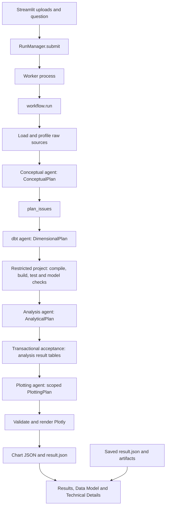

# ModeLLM Application Flow Reference

**This is the authoritative living map of the implemented application. Read it in full at the start of every new session, before the first response or other investigation, including for questions, overviews, and acknowledgements.** Maintain it in the same change whenever substantial changes affect contracts, prompts, signatures, dependencies, data flow, validation, or persistence.

Reviewed: 2026-10-21. Contract version: `4`. This reference describes the current working tree, including existing uncommitted application changes. Verify relevant source when applying the map; explicitly identify and reconcile any discrepancy so this authoritative reference stays accurate.

## Purpose and navigation

ModeLLM accepts related datasets and a natural-language question, constructs a dimensional model, executes analytical queries, and produces a dashboard. This document traces **Pydantic contracts ↔ prompt expectations ↔ Python producers, validators, and consumers**. It distinguishes instructions given to an agent from constraints enforced by Python.

1. [Component and dependency map](#component-and-dependency-map)
2. [Execution modes and flow index](#execution-modes-and-flow-index)
3. [Submission and worker supervision](#submission-and-worker-supervision)
4. [Source loading and profiling](#source-loading-and-profiling)
5. [Conceptual modelling](#conceptual-modelling)
6. [dbt implementation and validation](#dbt-implementation-and-validation)
7. [Analysis and result acceptance](#analysis-and-result-acceptance)
8. [Plotting and rendering](#plotting-and-rendering)
9. [Finding and evidence path — disabled](#finding-and-evidence-path--disabled)
10. [Shared agent runtime](#shared-agent-runtime)
11. [Run state, artifacts, and presentation](#run-state-artifacts-and-presentation)
12. [Settings, budgets, telemetry, and deployment](#settings-budgets-telemetry-and-deployment)
13. [Coupling and verification map](#coupling-and-verification-map)
14. [Contract field reference](#contract-field-reference)
15. [Python signature reference](#python-signature-reference)

Signature notation preserves source annotations and defaults. A function without a return annotation remains unannotated here; its actual output is described in the relevant flow. `AcceptedResults` is the workflow alias `list[tuple[AnalysisSpec, AcceptedAnalysisResult]]`. `T` in the runtime is bound to Pydantic `BaseModel`.

## Component and dependency map

| Component / source | Owns | Calls or consumes | Produced interface |
| --- | --- | --- | --- |
| [app.py](app.py), [src/ui/app.py](src/ui/app.py) | CLI saved-run selection; Streamlit composition, drafts, access gate, submission, polling | `RunManager`, `load_saved_run`, view and live-progress functions | Upload tuples, question, `RunJob`, session result |
| [src/execution.py](src/execution.py), [src/worker.py](src/worker.py) | Admission, worker lifecycle, shared model budgets, deadlines | `ReleaseSettings`, `RunWorkspace`, `workflow.run`, usage and cleanup | Request manifest; terminal `RunState` through a future and disk |
| [src/workflow.py](src/workflow.py) | Explicit stage order, acceptance and local repairs | Source functions, agents, dbt, modelling checks, analysis, renderer, `RunRecord` | Events, proposals, accepted results, chart associations |
| [src/data.py](src/data.py), [src/database.py](src/database.py) | Ingestion, profiling, candidate relationships, DuckDB connection policy | Run database and settings | `raw` tables, plain profile/relationship/schema dictionaries |
| [src/agents.py](src/agents.py) | Stage-specific prompt payloads, schema and tool selection | Prompt constants, contracts, tools, runtime | `ConceptualPlan`, `DimensionalPlan`, `AnalyticalPlan`, `PlottingPlan`; dormant `AnalysisFinding` |
| [src/agent_runtime.py](src/agent_runtime.py), [src/context_cost.py](src/context_cost.py) | Strands/Bedrock execution, structured correction, cache layout, output offloading | Settings, budgets, telemetry attributes, Pydantic schema | Structured model object and correlated execution events |
| [src/core/contracts.py](src/core/contracts.py) | Pydantic output/input shapes and intrinsic validators | Pydantic; installed Plotly template registry | Schemas delivered to agents and parsed by Python |
| [src/core/prompt/](src/core/prompt/) | Agent responsibilities and behavioral instructions | Constants selected in `agents.py` | System instruction strings |
| [src/modelling_validation.py](src/modelling_validation.py) | Run-specific source/plan references and built-model interfaces | `ConceptualPlan`, profiles, schemas, DuckDB rows | `ValidationIssue` objects or error strings |
| [src/dbt.py](src/dbt.py), [src/sql_policy.py](src/sql_policy.py) | Generated project writing, restricted SQL/Jinja/YAML, dbt subprocess | `DimensionalPlan`, declared source/model names, budget and connection settings | Built `main` tables; dbt execution and node diagnostics |
| [src/analysis.py](src/analysis.py), [src/tools/analysis_tools.py](src/tools/analysis_tools.py) | Validated-model inspection, final SQL assembly, atomic acceptance | SQL policy, analysis contracts, DuckDB | Accepted `analysis` tables, column profiles, frames, scalar metrics |
| [src/visualisation.py](src/visualisation.py) | Supported encodings, row selections, scoped validation and actual rendering | `AnalysisSpec`, `AcceptedAnalysisResult`, `PlottingPlan`, pandas, Plotly Express and native grid traces | In-memory figures and errors suitable for correction |
| [src/tools/result_tools.py](src/tools/result_tools.py) | Accepted-result category inspection; dormant finding evidence | One accepted relation and its fields; optional spec and registry | Category counts; stored evidence and bound finding text |
| [src/run.py](src/run.py), [src/workspace.py](src/workspace.py), [src/storage.py](src/storage.py) | Run types, atomic records, workspace paths, input cleanup and retention | Filesystem, settings | `result.json`, ownership/request manifests and run directories |
| [src/ui/views.py](src/ui/views.py), [src/ui/saved_run.py](src/ui/saved_run.py) | Dashboard, model previews, diagnostics and saved-run loading | Run dictionaries, chart JSON, database, plan/schema metadata | Streamlit views |
| [src/ui/live.py](src/ui/live.py), [src/ui/progress.py](src/ui/progress.py) | Event-to-progress and chronological-stream projections | Stage/kind strings and recorded structured tool messages | Timeline and phase summaries |
| [src/ui/model_diagram.py](src/ui/model_diagram.py), [src/ui/presentation.py](src/ui/presentation.py) | Declared relationship diagram and display formatting | Saved plan, built schemas, figure/table/text values | HTML/SVG diagram and display-only formatting |
| [src/usage.py](src/usage.py), [src/experiments.py](src/experiments.py), [src/telemetry.py](src/telemetry.py) | Reported usage/cost, local experiment ledger, optional trace export | Provider response events, run state, source/code provenance | Usage summaries, CSV ledger, OpenTelemetry spans and optional Langfuse link |
| [Dockerfile](Dockerfile), [infra/](infra/), [.github/workflows/](.github/workflows/) | Packaging, CI, smoke checks and deployment | Locked Python environment, CloudFormation, ECR, ECS, Secrets Manager | One Streamlit service with supervised run workers |

## Execution modes and flow index



| Mode | Entry | Behavior |
| --- | --- | --- |
| Live UI | `app.py → render_app() → render_run()` | UI uses `RunManager`; worker performs the workflow. The Run fragment polls the current disk record. |
| Direct Python workflow | `workflow.run(paths, request, root, ...)` | Runs synchronously with settings, a workspace and model budget. Does not perform `RunManager` admission or parent-process supervision. |
| Development harness | `python -m harness` | Imports arbitrary frozen post-dbt bundles and runs Analysis, fixed-result Plotting or both through acceptance, without UI/ingestion/dbt. Uses isolated trial workers, immutable inputs/code and private workflow stage helpers; its own supervisor and experiment policy bound execution. See [harness/README.md](harness/README.md). |
| Saved dashboard | `app.py --saved-run PATH → render_app(saved_run=...)` | Loads a finished run dictionary and existing artifacts. Does not start agents or normal live-run cleanup. |
| Finding generation | `_generate_findings(...)` | Implemented but not called by `_run`. Active runs set `findings`, `finding_attempts`, and `evidence` to empty lists. |
| Legacy database retention | `storage.cleanup_run_databases(...)` | Remains callable; the current workflow/manager use whole-workspace `cleanup_run_workspaces(...)`. |

| Flow | Agent output contract | Python acceptance | Downstream dependency |
| --- | --- | --- | --- |
| Conceptual | `ConceptualPlan` | Pydantic then `plan_issues` | dbt generation and Analysis |
| Model construction | `DimensionalPlan` | Pydantic, exact model set, generated-file policy, dbt, `validate_built_models` | Validated `main` models and schemas |
| Analysis | `AnalyticalPlan` | Pydantic, SQL access policy, transactional materialisation, field/component references and chart count | Accepted results and Plotting context |
| Plotting | Dynamic subclass of `PlottingPlan` | Pydantic plus exact selection, supported arguments, real rendering and nonempty traces | Chart files and UI associations |
| Finding — disabled | `AnalysisFinding` or `EarlyValidatedAnalysisFinding` | Evidence inspection and `render_finding` | Bound text, evidence and caveats |

The concrete call boundaries are below; full argument lists appear in the corresponding flow and signature index.

| Caller | Called boundary | Returned value and next consumer |
| --- | --- | --- |
| `app.py` | `ui.app.render_app` | Composes live or saved views; routes submission through `render_run` |
| `ui.app.render_run` | `RunManager.submit` | `RunJob` stored in session state; `_collect_run` reads its workspace/future |
| `RunManager._supervise` | `RunManager._execute_worker` | Terminal `RunState` resolves the submitted future |
| Worker CLI | `worker.main → workflow.run` | Workflow writes the workspace record; worker exits after telemetry flushing |
| `workflow.run` | `workflow._run` | `RunState`; outer settings/budget contexts and input cleanup wrap execution |
| `workflow._run` | `workflow._prepare_sources` | `(names, profiles, links)` passed into conceptual/model stages |
| `workflow._run` | `workflow._build_conceptual_model` | Accepted `ConceptualPlan` passed into model generation and Analysis |
| `workflow._build_conceptual_model` | `agents.conceptual → invoke`; then `plan_issues` | Proposed plan; structured issues determine acceptance or revision |
| `workflow._run` | `workflow._build_models` | Validated model names; also stores schemas consumed by Analysis |
| `workflow._build_models` | `agents.implement → invoke`; then `write_project`, `run_dbt`, `validate_built_models` | Proposed files, command results and interface issues determine acceptance or repair |
| `workflow._run` | `workflow._accept_analysis` | `(AnalyticalPlan, AcceptedResults)` used for warnings, metrics and plotting |
| `workflow._accept_analysis` | `agents.analyse → invoke`; then `accept_analyses` | Proposal and accepted result pairs; acceptance errors feed the Analysis repair |
| `accept_analyses` | `analysis_statement`, `validate_result_semantics` | Executable final SQL and checked result metadata inside one transaction |
| `workflow._run` | `workflow._render_visualisations` | Mutates chart/spec/attempt state; figure files are persisted before success events |
| `workflow._render_visualisations` | `load_result_frame`, `representation_selections`, `agents.plot` | Full frame, exact row selections and a plot candidate for each scheduled view |
| `agents.plot` | `accepted_result_plot_schema → invoke` | Scoped Pydantic output schema returns renderer errors to the current SDK conversation |
| Scoped validator and workflow final guard | `validate_plot_candidate → validate_plot_spec`, `render_plot` | Checked in-memory figure; final workflow writes its JSON artifact |
| Workflow and runtime emitters | `RunRecord.emit → RunRecord.save → atomic_json` | Timestamped event and full disk snapshot consumed by polling, UI, usage and ledger |
| `workflow._run` | `summarize_usage`, `_track → record_run` | Reported usage in state and derived local ledger |
| `ui.app.render_app` in saved mode | `load_saved_run` | Terminal dictionary with rebased artifact directory, consumed by the same views |
| Dormant `_generate_findings` | `agents.interpret`, `DuckDBResultTools.inspect_result`, `render_finding` | Evidence-backed text and records; currently bypassed by `_run` |

## Submission and worker supervision

Sources: [src/ui/app.py](src/ui/app.py), [src/execution.py](src/execution.py), [src/worker.py](src/worker.py), [src/workspace.py](src/workspace.py).

```text
RunManager.submit(self, uploads: list[tuple[str, bytes]], request: str, owner: str) -> RunJob
RunManager._supervise(self, workspace: RunWorkspace) -> RunState
RunManager._execute_worker(self, workspace: RunWorkspace) -> RunState
workflow.run(paths: list[Path], request: str, root: Path, *,
             on_event: Callable | None = None, workspace: RunWorkspace | None = None,
             settings: ReleaseSettings | None = None) -> RunState
```

1. `render_run` converts Streamlit files to `(filename, bytes)` tuples and supplies a session owner token. **Add Survey Demo** and **Add Churn Demo** load their explicit file lists from `samples/survey/` and `samples/churn/` with the matching question in `samples/sample_questions.py`. The compact buttons sit side by side beside the uploader. Each selection replaces the pending files and prompt and increments the native uploader key, isolating previous selections. The browser bridge consumes pending files once and marks the matching input before dispatch to prevent duplicate insertion. Inserting demo data only populates the draft; submission uses the same route as uploaded files.
2. `_live_access` checks `live_enabled`; production also uses the access code. `submit` independently validates input, live availability, one active run, owner cooldown, daily admission count, workspace allowance and free disk capacity.
3. `RunWorkspace.create` creates an owned run directory. `persist` writes input files. `request.json` records input paths, request and the settings snapshot; the initial `result.json` records running status, identity and empty events.
4. `submit` returns a `RunJob`: workspace, `Future[RunState]`, and current progress. A supervisor thread starts `python -m src.worker --run-dir ...` in a new process group. The live access code is removed from the worker environment.
5. `worker.main()` opens the owned workspace, checks input paths, reconstructs `ReleaseSettings`, configures optional telemetry, and calls `workflow.run`.
6. `workflow.run` validates the submission, snapshots the effective runs root, persists externally supplied paths when needed, enters settings/budget/trace contexts and calls `_run`. Its `finally` removes copied inputs.
7. The parent watches shutdown, deadline, worker exit and workspace size. It terminates the worker process group, removes inputs, and creates a failed terminal record when the worker failed or supplied no terminal result. Admission is released in `_supervise`'s `finally`.
8. `_collect_run` polls only this session's workspace record. When the future finishes it stores the final result, clears the job and selects Results after success.

The worker protocol is application-owned JSON, not a Pydantic model. `RunJob`, `RunState`, and `RunProgress` are typing declarations; reading JSON does not instantiate or validate them.

## Source loading and profiling

Sources: [src/data.py](src/data.py), [src/database.py](src/database.py), `workflow._prepare_sources`.

```text
_prepare_sources(record: RunRecord, paths: list[Path]) -> tuple[list[str], dict, list[dict]]
load_raw(database: Path, paths: list[Path]) -> list[str]
profile(database: Path, names: list[str]) -> dict
relationships(database: Path, profiles: dict) -> list[dict]
schemas(database: Path, names: list[str], schema: str = 'main') -> dict
```

| Step | Transformation | Stored / consumed |
| --- | --- | --- |
| Ingest | Accept 2–6 CSV, Parquet, JSON, JSONL or NDJSON files. Production defaults to 250,000 rows, 100 columns and 20 MiB per file, with 60 MiB total uploads; development row/shape/byte caps are unset unless overridden. The uploader displays effective configured limits. Ingestion reads at most the row cap plus one and rejects oversized files before profiling, naming the offending file; it never accepts a truncated sample. Normalise filenames to distinct safe dataset identifiers. Trusted ingestion opens DuckDB with external access enabled for file readers. Reject a detected single-field wrapped record array. | `raw.<dataset>` tables; `state.raw_names` |
| Profile | Count rows, nulls, exact distincts, duplicate rows, sample values and selected bounds; collect top values when cardinality is small. Enforce configured row, column and serialized-profile limits. | `state.profiles`; Conceptual and dbt agent context |
| Relationships | Look for shared `_id` fields with a unique parent column, then count unmatched child rows. | `state.relationships`; candidate evidence for Conceptual/dbt, later orphan warnings |
| Model schema | `DESCRIBE` built tables to obtain exact output names and DuckDB types. | `state.model_schemas`; Analysis tools and prompt |
| Model summary | Count rows and select three preview rows from each validated model. | `summarize_models` output passed to Analysis |

Profiles and relationships are plain dictionaries, not Pydantic contracts. A profile contains `rows`, `columns`, and `duplicate_rows`; each column records `name`, `type`, `nulls`, `distinct`, `unique`, `examples`, `top_values`, and `bounds`. A candidate relationship records `from`, `to`, `cardinality`, `orphan_rows`, and `evidence`.

`database.connect` centralises resource settings, disabled extension autoload/install, locked configuration and external access policy. Normal analysis/result connections are read-only with external access disabled.

## Conceptual modelling

Sources: [src/agents.py](src/agents.py), [src/core/prompt/conceptual.py](src/core/prompt/conceptual.py), [src/core/contracts.py](src/core/contracts.py), [src/modelling_validation.py](src/modelling_validation.py), `workflow._build_conceptual_model`.

```text
conceptual(request: str, profiles: dict, relationships: list[dict], emit: Callable,
           feedback: list[ValidationIssue] | None = None, previous: ConceptualPlan | None = None,
           *, cost_experiments: frozenset[str] | None = None,
           trace_attributes: Mapping[str, AttributeValue] | None = None) -> ConceptualPlan
plan_issues(plan: ConceptualPlan, profiles: dict,
            relationships: list[dict] | None = None) -> list[ValidationIssue]
```

**Contract naming:** The four active outputs are `ConceptualPlan`, `DimensionalPlan`, `AnalyticalPlan`, and `PlottingPlan` (displayed as “Plotting Plan”). These replace the earlier `AnalyticalPlan` (conceptual), `DbtImplementation`, `AnalysisPlan`, and `PlotSpec` names respectively. Field shapes and saved JSON keys are unchanged; the UI recognises both current and legacy proposal tool names by stage.

**Prompt assembly:** `CONCEPTUAL_MODEL`, optionally followed by `CONCEPTUAL_REFERENCE_GUIDANCE`. Stable keys are `request`, `profiles`, `candidate_relationships`. Revision keys are `previous_plan_issues`, `previous_plan`. With conceptual caching they become two text blocks; otherwise they are one serialized object. No domain tools are attached to this stage.

| Contract / fields | Prompt expectation | Python interpretation and consumer |
| --- | --- | --- |
| `ConceptualPlan.business_processes`, `.facts`, `.dimensions` | Source-supported processes, atomic facts, connected dimensions and useful reusable structure | `plan_issues` checks distinct names, at least one fact and implemented process references; dbt receives the full accepted plan. It does not prove that the proposed business structure is appropriate. |
| `DimensionPlan` identity and `grain_key_fields`; `FactPlan.fact_type`, `.grain`, `.modelling_rationale` | Declare supported identity and grain; request-specific reporting rules belong to Analysis | Reference checks resolve declared keys; built validation checks duplicates for declared grain keys. Grain/rationale prose and fact-type appropriateness are not interpreted by code. |
| `ModelOutput.name`, `.description`, `.definition`, `.additivity` | Declare every output once with exact inputs, canonical meaning and measure metadata | Duplicate names and missing references are rejected. dbt must emit required names; meaning and additivity remain agent declarations. |
| `FieldDefinition.kind`, `.inputs`, `.explanation`, `.value` | `copy`: one reference; `derive`: real inputs; `constant`: explicit scalar value; `generate`: independent generation | Pydantic checks these shapes, explicit constant presence and required explanations. `plan_issues` resolves references and checks field/model dependency cycles. dbt turns intent into SQL; Python does not compile definitions into SQL. |
| `FieldRef.kind`, `.dataset`, `.model`, `.column` | Exact run-local source or planned-model field; names can contain punctuation | Pydantic enforces mutually exclusive reference targets. `plan_issues` resolves containers, columns and declared source scope. |
| `FactDimensionLink`, `SourceMatchPath`, `MatchStep`, `MatchPair`, `OutputKeyPair` | Explicit equality paths and canonical output key pairs, including contributing sources and unmatched policy | Plan validation checks references, source reachability, one destination per step, final dimension endpoint, key pairs and dependency cycles. It does not prove match uniqueness or that generated joins implement the declared policy. |
| `ConceptualPlan.assumptions`, `.unresolved_questions`; `FactDimensionLink.unmatched_explanation` | State chosen interpretations, missing evidence and the effect of unmatched handling | Passed to dbt and/or presented to users; prose does not override structured references or validate an interpretation. |

`relationships` is accepted by `plan_issues` but is not used by its current body. It remains agent context; Python reference acceptance does not independently verify the candidate cardinality.

**Acceptance and revision:** `_build_conceptual_model` records every proposal in `conceptual_attempts`, saves it, then applies `plan_issues`. It permits one revision (`MAX_CONCEPTUAL_REVISIONS = 1`) with the rejected plan and structured issues. Remaining issues fail the run; success writes `state.plan`.

**Consumers:** `_build_models` uses the accepted plan, expected model names and definitions; Analysis receives the plan after model validation; the UI uses facts/dimensions, grains and explicit key pairs for model views. `CONCEPTUAL_MODEL_EDIT` is an unused alternate prompt constant; it is not selected in `agents.py`.

## dbt implementation and validation

Sources: [src/core/prompt/modelling.py](src/core/prompt/modelling.py), [src/dbt.py](src/dbt.py), [src/sql_policy.py](src/sql_policy.py), [src/modelling_validation.py](src/modelling_validation.py), `agents.implement`, `workflow._build_models`.

```text
implement(plan: ConceptualPlan, profiles: dict, relationships: list[dict], emit: Callable,
          failure: str = '', previous: DimensionalPlan | None = None, *,
          cost_experiments: frozenset[str] | None = None,
          trace_attributes: Mapping[str, AttributeValue] | None = None) -> DimensionalPlan
write_project(project: Path, database: Path, source_names: list[str],
              implementation: DimensionalPlan) -> None
run_dbt(project: Path, command: str) -> dict
validate_built_models(database: Path, plan: ConceptualPlan,
                      built_schemas: dict[str, dict[str, str]]) -> list[str]
```

**Prompt assembly:** system instructions are `DIMENSIONAL_MODEL`. Stable keys: `plan`, `profiles`, `relationships`; repair keys: `previous_failure`, `previous_implementation`. No domain tools are attached. `DIMENSIONAL_MODEL_2` is an unused alternate constant.

| Contract / expectation | Enforced by | Result / downstream effect |
| --- | --- | --- |
| `DimensionalPlan.files: list[DbtFile]`; each `path` is a flat planned model SQL filename or `schema.yml` | Pydantic path pattern, duplicate-path and exactly-one-schema validators; workflow compares the returned SQL model set with the accepted plan | Proposal saved as `attempts/dbt_NN.json`; unplanned or missing SQL models trigger repair |
| `DbtFile.content` implements the accepted plan using `source('raw', ...)` and `ref(...)` | `validate_dbt_files` and `render_relations_only` permit only literal declared relation calls, then SQL policy checks the rendered query | `write_project` writes generated files only after policy checks |
| No generated macros, commands, packages, hooks or source declarations | Restricted Jinja AST, SQL validation, schema YAML key/test allowlists | Application owns `sources.yml`, project config and DuckDB profile |
| Finite calendars may be generated in dbt | `validate_analysis_sql(..., source_names=..., allow_calendar_generation=True)` and `_validate_calendar_generation` | Narrow dbt-only exception for `range` / `generate_series`, including allowed `UNNEST`; Analysis cannot use this exception |
| `schema.yml` declares justified built-in tests | `validate_schema`, `_tests`; dbt executes declared `unique`, `not_null`, `relationships` tests | Test results and messages go into `dbt_runs`, `dbt_results` |
| Exact declared grain and output references | `validate_built_models` checks missing planned columns, duplicate declared grain keys, join key and match-path endpoint columns | Validated names/schemas become the Analysis input |
| `DimensionalPlan.explanation` reports implementation and repairs | Stored as `dbt_explanation`, available in proposal diagnostics | Text is not checked against SQL semantics |

`write_project` emits `dbt_project.yml`, `profiles.yml`, application-owned `models/sources.yml`, and the generated model files. Models are materialized as tables in DuckDB `main`. Before rewriting, it removes old `.sql`/`.yml` files in that run's models directory.

The workflow runs **compile → build → test**, then reads schemas and applies built-model checks. Passing compile/build/test alone is insufficient. Built checks allow extra output columns; they require planned outputs to exist and enforce supplied grain keys, rather than proving transformation prose or arbitrary business semantics.

`run_dbt` accepts only `compile`, `build`, or `test`; it uses the current Python environment's dbt executable where available. The subprocess receives a reduced environment and a run-local home/temp directory. Time is bounded by dbt timeout and remaining run budget. It returns `{'command', 'ok', 'output'}` with bounded diagnostic output; `dbt_results` reads node `name`, `status`, and `message` from `target/run_results.json`.

**Repair:** up to two repairs (`MAX_DBT_REPAIRS = 2`), each returning the complete project. Failures include model-set mismatch, policy/write errors, dbt errors, missing fields or duplicate grain rows. The workflow records `dbt_attempts` with artifact, status and error, sends the latest bounded diagnostics and previous proposal to the same stage in a new invocation, then fails if repairs are exhausted. Success writes `model_names`, `model_schemas`, and `repair_attempts`.

## Analysis and result acceptance

Sources: [src/core/prompt/analysis.py](src/core/prompt/analysis.py), [src/agents.py](src/agents.py), [src/tools/analysis_tools.py](src/tools/analysis_tools.py), [src/analysis.py](src/analysis.py), `workflow._accept_analysis`.

```text
analyse(request: str, plan: ConceptualPlan, model_schemas: dict, summaries: dict,
        emit: Callable, database: Path, feedback: str = '', previous: AnalyticalPlan | None = None,
        *, cost_experiments: frozenset[str] | None = None,
        trace_attributes: Mapping[str, AttributeValue] | None = None) -> AnalyticalPlan
analysis_statement(spec: AnalysisSpec, plan: AnalyticalPlan, model_names: list[str]) -> str
accept_analyses(database: Path, model_names: list[str], analysis: AnalyticalPlan,
                *, max_charts: int | None = None) -> list[tuple[AnalysisSpec, AcceptedAnalysisResult]]
validate_result_semantics(spec: AnalysisSpec, result: AcceptedAnalysisResult) -> None
```

**Prompt assembly:** `ANALYSIS`, optionally followed by `ANALYSIS_PREVIEW_GUIDANCE`. Stable keys: `request`, `conceptual_plan`, `validated_schemas`, `model_summaries`, `available_plots`, `limits` (`max_analyses`, `max_charts`). Repair keys: `previous_analysis`, `previous_acceptance_error`.

**Tools:** `DuckDBAnalysisTools(database, list(model_schemas))` exposes `list_models()`, `describe_model(model)`, and `query_data(sql, limit)`. With `small_analysis_previews`, the tool remains named `query_data` but its default limit is 20 instead of 500. An explicit limit is clamped to 1–500. Tool outputs contain `columns`, `row_count`, `truncated`, and `rows`; all access is restricted to this run's validated `main` models.

| Analysis field | Prompt expectation | Executable check / consumer |
| --- | --- | --- |
| `AnalyticalPlan.analyses` | Useful complete results within run limits | Pydantic requires at least one; workflow checks `max_analyses`; results are accepted together |
| `AnalyticalPlan.qualifications` | Reuse a common population across related views | Distinct IDs and SQL scope checked; `analysis_statement` resolves references and builds the population CTE |
| `AnalysisSpec.query` | Final reproducible SQL with a direct or qualified path | `QueryDefinition.qualification_choice`, SQL policy, actual DuckDB execution |
| `title`, `question` | Describe the actual result without promising an unavailable transformation | Passed to Plotting, run records and UI; prose meaning is not validated |
| `concept_id` | Group related analyses of one concept | Stored on results/charts; Results groups by it. It neither creates charts nor reaches Plotting's current prompt. |
| `population_definition`, `observation_rule`, `rationale` | Explain included population, extra rules and analytical method, separately from presentation intent | Stored with the proposal and delivered to Plotting in `analytical_result`; used in UI methodology. Not verified against SQL. |
| `grain` | Describe one returned row precisely | Delivered to Plotting and UI/dormant Finding; no automatic check that SQL rows match this prose |
| `dimensions`, `measures` | Annotate returned fields, units/calculation basis and additivity | Declared field names must exist. Descriptions, semantic types and additivity reach Plotting. Code does not require all result columns to be annotated or declarations to be unique. |
| `AnalysisMeasure.components` | Project actual numeric numerator and denominator fields | Acceptance checks both references are present and numeric and `scale` is finite and positive. It does not prove the ratio expression uses them. |
| `variant_field` | Identify alternate views through distinct row values, including null | Acceptance checks the field and planned chart count; `representation_selections` expands values into exact filters. It does not select measure columns. |
| `visualisation_goal` | Distinguish essential comparisons from supporting context using returned rows; leave channels/functions to Plotting and state material presentation limitations | Delivered as free-form text to Plotting. Analysis instructions require checking the final query and scheduled result shape against those comparisons. There is no structured required-measure/view contract or semantic feasibility validator. |
| `AnalyticalPlan.warnings` | Remaining assumptions, data or presentation limitations | Added to run `quality_warnings` and shown in Technical Details; not delivered to Plotting |

**SQL paths:**

- `direct`: `validate_analysis_sql(spec.query.sql, model_names)` returns the final SQL. `qualification_id` must be null.
- `qualified`: look up `SharedQualification.sql`; validate it against main models. Validate the final query so it reads only `__modellm_population`, then construct `WITH __modellm_population AS (<base>) SELECT * FROM (<variant>) AS accepted_variant` and validate the combined statement. Intermediate fields needed by a qualified view must be projected by its qualification.
- SQL policy permits one read-only SELECT/UNION query, resolves CTE scope, restricts relations and blocks external/table-function access. Qualification IDs are distinct and qualifications cannot redefine the reserved population CTE.

**Acceptance transaction:** create `analysis` schema if needed; for each proposal execute `CREATE OR REPLACE TABLE analysis."result_NN" AS <final SQL>`, count all rows, read exact columns/types and run DuckDB `SUMMARIZE`. Build an `AcceptedAnalysisResult` with result ID, fresh acceptance ID, relation, row count, columns and profiles, then check declared field/component references. If a chart limit is supplied, count one chart per unpartitioned/empty result, otherwise one per distinct variant value, including null. Exceeding the accumulated limit rejects the proposal. Commit only after all results pass; any failure rolls the transaction back.

`AnalysisAcceptanceError(index, title, error)` identifies the rejected result; shared qualification errors use index `-1`. `_accept_analysis` permits one new Analysis invocation with the rejected proposal and error (`MAX_ANALYSIS_REPAIRS = 1`). The configured analysis-count check is outside the `AnalysisAcceptanceError` wrapping and therefore fails directly rather than entering that repair path. Invocation/provider failures also propagate.

**Full results versus previews:** accepted SQL is executed independently of tool previews. Acceptance materializes the full final result. The 500-row preview ceiling and `execute_analysis_sql`'s default 5,000-row complete-result cap belong to the inspection helper; `accept_analyses` does not apply those caps. The tool records normalized SQL strings in `executed_queries`, but current `agents.analyse` does not require final SQL to match that set.

**Stored handoff:** `state.analysis` is `AnalyticalPlan.model_dump()`. Each `state.analysis_results` item stores `title`, `result_id`, `relation`, `rows`, `columns`, `acceptance_id`, `executed_sql`, and `concept_id`; it does not persist the full `AcceptedAnalysisResult.profile` there. Plotting receives the in-memory accepted object. `state.metrics` contains numeric cells from single-row results, keyed from title and column.

## Plotting and rendering

Sources: `agents.plot`, `PLOTTING` in [src/core/prompt/analysis.py](src/core/prompt/analysis.py), [src/visualisation.py](src/visualisation.py), `DuckDBResultTools.category_counts`, `workflow._render_visualisations`.

```text
plot(spec: AnalysisSpec, result: AcceptedAnalysisResult, emit: Callable,
     database: Path, selection: list[ResultFilter] | None = None, *,
     original_request: str, frame: pd.DataFrame, title: str | None = None,
     cost_experiments: frozenset[str] | None = None,
     trace_attributes: Mapping[str, AttributeValue] | None = None) -> PlottingPlan
accepted_result_plot_schema(result: AcceptedAnalysisResult,
                            selection: list[ResultFilter] | None = None, *,
                            frame: pd.DataFrame, title: str = '') -> type[PlottingPlan]
validate_plot_candidate(frame: pd.DataFrame, plot: PlottingPlan, result: AcceptedAnalysisResult,
                        selection: list[ResultFilter], title: str)
render_plot(frame: pd.DataFrame, plot: PlottingPlan, title: str)
```

**Scheduling:** `_render_visualisations` loads the full accepted frame once per nonempty result. Without `variant_field`, `representation_selections` yields `(None, [])`. With one, it reads distinct values in sorted order and yields an `eq` selection per value or `is_null` for null. For each selection the workflow calls Plotting once; SDK corrections stay inside that invocation. Empty results create an annotated empty figure without any model call.

**Actual prompt payload:**

| Block / key | Producer | Meaning / limits |
| --- | --- | --- |
| Shared `available_plots` | `plot_descriptions()` | Descriptions of installed Plotly Express functions plus native grid heatmap/contour data requirements; the same catalogue also goes to Analysis |
| Shared `available_plot_arguments` | `plot_capabilities()` | Exact supported column arguments and scalar options per installed function |
| Shared `renderer_templates` | `registered_plot_templates()` | Installed template names accepted by Pydantic validation |
| `title`, `question`, `original_request` | `AnalysisSpec` and original run request | The prompt, validator and renderer share the effective variant title when supplied |
| `presentation_selection` | Workflow-generated `ResultFilter` list | Exact row subset to preserve; never an invitation for Plotting to add filters |
| `visualisation_goal` | `AnalysisSpec` | Presentation intent expressed by Analysis |
| `analytical_result.grain`, `.dimensions`, `.measures` | Declared Analysis semantics | Agent-authored metadata; does not independently verify SQL meaning |
| `analytical_result.population_definition`, `.observation_rule`, `.rationale`, `.variant_field` | Existing `AnalysisSpec` fields | Preserves population/calculation context, analytical method and declared alternate-view identity; Plotting reasons about these declarations without changing them |
| `analytical_result.profile_scope` | Context assembly | Explicitly labels the full-result scope so selected-view statistics are not assumed |
| `analytical_result.row_count`, `.columns`, `.profile` | Accepted result | Full-result count/schema/profile, not a profile recalculated for the selected variant |

The model is not sent the DataFrame rows, SQL, upstream model access, warnings, or `concept_id` in this prompt. Analysis instructions distinguish preparing a supported result shape from an unavailable renderer operation, keep methodological fields about actual data treatment, and require preserving the original purpose and recording unmet requirements. Plotting instructions distinguish essential comparisons from supporting information and ask the agent to reason about units, coordinate meaning and renderer operations, checking capability claims in analytical metadata against the catalogue. Preserving a supporting dimension does not request an additional series, partition, facet or filter; handoff suggestions about colour or slicing are assessed against the intended comparison groups. The prompt explains that categorical colour in a line plot creates separate traces within each line_group rather than recolouring successive segments of one intact line. Both prompts explicitly allow missing grid nodes to remain gaps rather than assuming complete coverage is required. No Python rule makes those semantic decisions. The DataFrame is captured by the Python validator. Its only attached domain tool, `category_counts(field: str, limit: int = 20) -> dict`, inspects categories in the accepted relation; it is not automatically restricted by the presentation selection. Tool results contain `field`, `truncated`, and `values` (`value`, `count`), with a 1–100 limit.

| `PlottingPlan` field / instruction | Python enforcement | Remaining boundary |
| --- | --- | --- |
| `function` names one available Plotly function | `plot_capabilities()` introspects Express functions and declares native grid heatmap/contour; `validate_plot_arguments` checks the name | Function availability does not prove that its semantics fit the result |
| `columns` maps supported channel arguments to exact accepted fields or nonempty field lists | `PlottingPlan.column_mappings` checks value shape; scoped validation checks argument support and field existence | Does not prove that all requested measures are visible, units are compatible, or coordinate systems suit geographic channels |
| `filters` equals supplied selection | Exact model-list equality checked by `validate_plot_spec`; `filter_frame` applies it to the actual DataFrame | No additional population filters are permitted |
| `options` contains supported scalar presentation settings | Intrinsic validator accepts scalar strings/numbers/booleans and registered templates; argument validator restricts keys to installed support | Options do not permit arbitrary Plotly dictionaries, labels mappings or graph-object overlays |
| Preserve calculated meaning; no new business aggregation, conversion, normalization or data filling | Prompt instruction and unchanged accepted data | Some Plotly functions perform their own aggregation; the validator does not establish analytical appropriateness |
| Choose a compatible, nonempty rendering and correct encoding failures | Dynamic `AcceptedResultPlottingPlan` validator calls `validate_plot_candidate` on real selected data | A figure with traces can still be misleading or visually unusable |
| Interpretable scales, units and identifiable series | Plotting prompt asks the agent to reason about combined channel partitions and preserve intended series; title is supplied by application rendering | Axis labels still use mapped field names; no automatic general rewrite or semantic validation of grouping or prose |

The supported column keys are defined in `PLOTLY_COLUMN_ARGUMENTS`, intersected with each installed function's signature. Supported presentation keys are `orientation`, `barmode`, `line_shape`, `markers`, `points`, `opacity`, `log_x`, `log_y`, `width`, `height`, `template`, and `text_auto`, also intersected per function. Native `heatmap` and `contour` support exact x/y/z field mappings and scalar `width`, `height`, `template`, `opacity`, `colorscale`, `showscale`, `reversescale` options. The catalogue combines runtime Express signatures with these explicitly supported native operations rather than freezing all functions in the schema. Plotting receives both descriptions and the `plot_capabilities()` dictionary; Analysis receives descriptions.

**Rendering:** the scoped schema copies the exact selection and captures frame/title. It validates references, invokes the same `render_plot` used by the final workflow guard, and rejects zero traces for a nonempty selection. `render_plot` filters rows and makes one supported Plotly chart. Express functions retain their existing path. Native `heatmap`/`contour` delegate to `render_grid`, which pivots explicitly mapped x/y/z cell fields without aggregation or interpolation. Duplicate cells, missing coordinates and nonnumeric z values are rejected. Heatmaps preserve first-seen category ordering and missing cells. Contours use sorted numeric coordinates and require at least one complete adjacent grid cell; scattered points alone are rejected with feedback explaining that Analysis must supply surface values. Both native traces disable gap connection. Surface construction, resolution, extent and calculation remain Analysis decisions and belong in its SQL and existing methodology fields. `imshow` still uses the full selected frame without column mappings. There is no mixed-chart overlay or independent secondary-axis builder.

**Correction and failure:** `ValueError`, `TypeError`, `KeyError` and `NotImplementedError` from candidate checks/rendering become a concise `PlotValidationError`. Unsupported arguments are reported together rather than one option per correction; feedback asks the agent to retain the essential comparisons. Pydantic validation feeds errors into Strands' existing structured-output correction conversation. Plotting passes `limits={'turns': 7}`; inspection, output and correction all consume that allowance. The final workflow guard repeats candidate validation. The workflow catches exceptions from the per-chart agent invocation and final candidate validation, including Bedrock/provider/transport failures, missing structured output, local invocation limits and rendering errors. It records the chart as skipped and continues to the next selection. Shared-budget violations use `RunBudgetExceededError`; during Plotting they record the current skipped chart and end scheduling without further model calls, preserving completed charts and allowing dashboard completion. Source-frame loading, selection scheduling, chart-count checks and chart file writes remain outside that catch and propagate to run failure. There is no outer plotting retry loop. Skipped-chart errors remain in persisted attempts/events and Technical Details; the live stream omits Plotting failure/model-failure notices.

**Artifacts and associations:** successful nonempty charts are `chart_<result_index>_<variant_index>.json`; empty-result charts are `chart_<result_index>.json`. `charts` entries carry `result_index`, `concept_id`, `title`, `file`. `plot_specs` contains successful specs and null for an empty-result figure; skipped charts add no spec. Its list index is not a reliable result index. Skipped `plot_attempts` include result/concept/relation/selection and error; accepted attempts currently contain title, status and plot only. Results joins charts by `result_index` and groups analyses by `concept_id`.

## Finding and evidence path — disabled

Sources: `workflow._generate_findings`, `agents.interpret`, `ANALYSIS_FINDING`, [src/tools/result_tools.py](src/tools/result_tools.py), finding contracts in [src/core/contracts.py](src/core/contracts.py).

`workflow._run` currently skips `_generate_findings` and explicitly initializes empty finding/evidence fields. The following map documents the retained callable implementation and saved-run presentation support; it is not part of a new live run.

```text
interpret(spec: AnalysisSpec, result: AcceptedAnalysisResult, emit: Callable,
          db: DuckDBResultTools, feedback: str = '', previous: AnalysisFinding | None = None,
          *, executed_sql: str, cost_experiments: frozenset[str] | None = None,
          trace_attributes: Mapping[str, AttributeValue] | None = None) -> AnalysisFinding
DuckDBResultTools.inspect_result(self, request: EvidenceRequest) -> dict
render_finding(finding: AnalysisFinding, registry: EvidenceRegistry) -> tuple[str, list[dict]]
```

**Prompt context:** title, question, concept ID, rationale, population definition, observation rule, grain, dimensions, measures, variant field, visualisation goal, executed SQL, and the accepted result dump. Repair context includes previous error/proposal and `registered_evidence`. The attached tool is `inspect_result`. The early-validation control selects `EarlyValidatedAnalysisFinding`; otherwise the output schema is `AnalysisFinding`.

| Contract | Prompt expectation | Python check / transformation |
| --- | --- | --- |
| `EvidenceRequest` | Inspect existing rows or supported summaries, not arbitrary SQL | `request_shape` separates row projection from grouped aggregates; limit 1–100; tool reparses SDK dictionaries into the model |
| `EvidenceAggregate` | Use count rows/distinct, sum, average, min or max | Field required except for row count; exact references; numeric sum/avg; sum permitted only for declared additive measures |
| `ResultFilter`, `EvidenceSort` | Structured selection and separate field/direction/null placement | Parameterized filter values; sort must be an output field/alias. Alternate representations must be selected singly or included in summary grouping. |
| `EvidenceRowRef` | Cite IDs actually returned by inspection | Registry resolves evidence and stable row IDs within the same acceptance ID and relation |
| `FindingStatement` / `FindingCell` | Bind every observed value, date and label to evidence placeholders | Shared shape checks require simple placeholder names, exact binding coverage, no formatting/conversion, and use of every selected alias; final renderer checks evidence columns |
| `AnalysisFinding.caveats` | State residual limitations without inventing outcomes | Retained as prose; no generic semantic verification |

`inspect` builds restricted SQL over one accepted relation and reads one extra row to detect truncation. `boundary_tie` compares the first sort field at the limit boundary. `EvidenceRegistry.register` stores the exact JSON-normalized records returned to the model, with `e_...` evidence and `r_...` row IDs. `render_finding` resolves stored values and formats templates without reexecuting evidence queries; it returns text and the used evidence records. Binding establishes value provenance, not the truth of surrounding language.

The dormant workflow creates a separate registry per result, persists registered evidence through its callback, and permits one finding repair while preserving the registry. Success stores text, evidence, caveats and methodology; failure after the final repair propagates. Existing saved findings remain displayable in the UI.

## Shared agent runtime

Sources: [src/agent_runtime.py](src/agent_runtime.py), [src/context_cost.py](src/context_cost.py), `RunBudget` in [src/execution.py](src/execution.py).

```text
invoke(prompt: str | list[dict], schema: type[T], stage: str, emit: Callable,
       system_prompt: str, tools: list | None = None, *,
       cost_experiments: frozenset[str] | None = None,
       trace_attributes: Mapping[str, AttributeValue] | None = None,
       context_directory: Path | None = None, limits: dict[str, int] | None = None,
       cache_policy: Literal['default', 'disabled'] = 'default') -> T
```

`invoke` runs async `_invoke` synchronously. `_invoke` constructs `BedrockModel` and `strands.Agent`, attaches stage tools, budget hooks and optional offload plugins, and calls `agent.stream_async(prompt, structured_output_model=schema, limits=...)`. The supplied Pydantic schema is also recorded as a `StructuredOutputTool` specification with system instructions. SDK structured-output correction occurs inside this invocation; workflow repairs are separate calls with a previous proposal and feedback.

| Runtime concern | Mapping |
| --- | --- |
| Model selection | `configured_model_id(stage)` chooses `plotting_model_id` only for `visualisation generation`; every other stage uses `model_id`. Defaults are defined in `config.py`, with separate environment overrides. |
| Provider options | Sonnet 5/5.5 omit explicit sampling; 5.5 wraps model streaming with automatic tool choice. Nova 2 Lite receives low-effort reasoning config. Other models receive temperature 0.1. These are code branches, not guarantees of provider availability. |
| Caching | Compatible Claude stages enable automatic five-minute cache configuration. Conceptual caching is controlled independently. For block prompts, a checkpoint follows the first text block. Plotting puts shared catalogue/templates first; per-chart context follows. The optional runtime keyword `cache_policy='disabled'` disables application/SDK explicit caching and checkpoint insertion and rejects incoming explicit checkpoints, including nested ones. Its default retains existing behavior. The requested policy is recorded in model-call events; configured caching is distinct from measured cache reads. |
| Context splitting | `split_stable_and_repair_context(stable, repair)` JSON-serializes both dictionaries with `default=str` into two text blocks. For Plotting, its second block is per-chart context even though the helper parameter is named `repair`. |
| Offloading | `offload_analysis` applies to `query_data`; dormant `offload_finding` to `inspect_result`. Strands `ContextOffloader` uses per-call `context/<call_id>` local storage, a 2,500-token threshold, 1,000-token preview and retrieval tool. Accepted results remain independent of those previews. |
| Global budget | `RunBudget` hooks run before/after internal model calls, checking time, call count and previously reported estimated cost. Response usage updates the same budget; a transport failure can mark usage unknown. Plotting alone passes `allow_unknown_usage=True`: unknown usage does not prohibit its calls, while reported cost, call and time limits still apply. The unknown flag remains set for reporting and strict checks in other stages. |
| Provider retries | Production sets botocore `total_max_attempts=1` (no transport retries); development leaves retry configuration to botocore/environment defaults. The latest recorded development service-unavailable failure exhausted four transport retries. Strands separately defaults to six attempts for its retryable throttling exceptions; these attempts also pass through budget hooks. Workflow adds no outer chart retry. |
| Local Plotting budget | Seven SDK turns, including inspection and corrections. A `limit_*` stop reason becomes `InvocationLimitError`; this is distinct from global limits. |
| Result | Missing structured output raises `RuntimeError`. Otherwise return `final.structured_output` of the requested model type. |

`configured_cost_experiments` enables all six known controls when its environment variable is unset; an explicit empty value disables them. Unknown names fail. Controls and affected stages are defined by `COST_EXPERIMENT_STAGES` and are recorded per run/call.

Disabling those cost experiments does not disable Analysis/Plotting caching. The development harness passes the runtime-only cache-policy override for explicit cache-off comparisons. It otherwise reuses production agents, SQL acceptance, scoped validators, scheduling and rendering. Worker-local adapters supply frozen summaries (the production acceptance helper normally recomputes them), capture invocation/result/selection identities, and optionally extend compatible schemas/metadata validation. No production prompt, contract shape, repair limit or stage default is changed by importing the harness.

Harness manifests, code/input snapshots, full accepted profiles, SDK/provider-bound captures, semantic review records and external-agent iteration gates live under `harness/`; experimental artifacts are isolated under its ignored `outputs/` and fixture folders. Its tests are explicitly collected with `pytest harness/tests`. It does not invoke ordinary run retention or the application CSV experiment ledger. See the [source-checked implementation reference](harness/IMPLEMENTATION_SPEC.md) for the private bindings and [usage guide](harness/README.md) for budgets, approval and evaluation limits. Saved-run production persistence remains unchanged.

Harness evaluation preserves per-result scenario checks and aggregates failures under each declared obligation; duplicate legacy check IDs fail explicitly. Coordinate checks use stable result/typed-selection comparison identities while view/event IDs remain trial-specific. Child gates require complete observed baseline/parent scenario/repetition coverage and matching comparisons. Named replay cases carry an explicit evidence, acceptance, plotting or analytical evaluation kind in their frozen trial plan. Evidence-only cases report unobserved assessments without executing SQL acceptance. The mixed-unit case renders its two recorded variants and inspects actual trace axes plus declared y-measure mappings using case-specific recorded unit evidence; general semantic/coverage questions remain review obligations.

**Recorded model events:** `model_call` started/completed, `contract_schema`, `reasoning`, `reasoning_status`, `model_text`, `tool_call`, `model_message`, `cache_usage`, `model_cycle`, and `model_failure`. Each call uses a generated `call_id`; messages and usage are correlated through it. Streaming text is buffered and flushed about every 0.5 seconds or at completed messages. The failure category string is a runtime diagnostic and does not itself decide whether the workflow skips a chart; Plotting catches per-chart invocation exceptions regardless of provider category.

## Run state, artifacts, and presentation

Sources: [src/run.py](src/run.py), [src/workspace.py](src/workspace.py), [src/ui/](src/ui/).

```text
RunRecord.emit(self, stage: str, kind: str, message: str,
               detail: dict[str, Any] | None = None, *, notify: bool = True) -> None
RunRecord.save(self) -> None
load_saved_run(path: str | Path) -> RunState
```

`RunRecord` holds a shared mutable state dictionary. `emit` timestamps an event, appends under a reentrant lock, writes an atomic full snapshot, then invokes an optional callback outside the lock. `complete` sets status and emits terminal success; `fail` stores the error and emits terminal failure. `atomic_json` writes a unique temporary file and replaces the target. Only `running`, `complete`, and `failed` are declared run statuses.

| Run fields | Producer | Consumers |
| --- | --- | --- |
| Identity/settings: `run_id`, `run_dir`, `request`, `started_at_utc`, `release_settings`, `contract_version`, `strands_version`, `cost_experiments` | `_run` and workspace | UI, trace metadata, diagnostics, ledger |
| Sources: `raw_names`, `profiles`, `relationships`, `experiment`, `storage_cleanup` | `_prepare_sources`, provenance, cleanup | Conceptual/dbt, source previews, quality warnings, ledger |
| Models: `plan`, `conceptual_attempts`, `dbt_attempts`, `dbt_explanation`, `dbt_runs`, `dbt_results`, `repair_attempts`, `model_names`, `model_schemas` | Conceptual/dbt workflow | Analysis, model diagram, Technical Details and progress |
| Analysis: `analysis`, `analysis_attempts`, `analysis_results`, `metrics` | `_accept_analysis` | Plot scheduling, UI methodology, dormant findings, ledger |
| Charts: `charts`, `plot_specs`, `plot_attempts` | `_render_visualisations` | Results, timeline, diagnostics, ledger |
| Finding compatibility: `findings`, `finding_attempts`, `evidence` | Empty in active `_run`; dormant generator when explicitly called | Saved findings, evidence and methodology views |
| Outcome: `status`, `error`, `failure_category`, `quality_warnings` | Workflow or supervisor | Dashboard gate, user messages, diagnostics, ledger |
| Observability: `events`, `usage`, `runtime_budget`, `langfuse_trace_url`, `experiment_tracker_error` | Runtime, workflow, tracing, tracker | UI, budgets/reporting, ledger, optional trace link |

At successful completion, `quality_warnings` combines source orphan/duplicate notices, Analysis warnings and any finding caveats. `_run` catches stage exceptions and marks the run failed, then stores budget and usage summaries. `_track` isolates ledger failures by recording `experiment_tracker_error` and emitting a non-notifying event; ledger failure does not reverse a successful workflow.

Per-run layout is owned by `RunWorkspace`:

```text
<runs_root>/<run_id>/
  workspace.json                 ownership format, identity, owner, creation time
  request.json                   manager-submitted input paths, request, settings
  input/                         copied uploads; removed after execution/failure
  modellm.duckdb                  raw, main and accepted analysis tables
  dbt/                           generated project, target artifacts and logs
  attempts/dbt_NN.json            complete dbt proposals
  context/<call_id>/              optional offloaded tool outputs
  spill/                         DuckDB temporary storage
  chart_<result>_<variant>.json   normal rendered figure
  chart_<result>.json             empty-result figure / legacy chart naming
  result.json                    current and terminal run snapshot
```

`request.json` is created by `RunManager`; a direct `workflow.run` need not create it. The run ID uses UTC minute timestamp plus a random suffix. `acceptance_id` identifies an accepted result for evidence; `result_index` associates saved charts with analyses; `concept_id` groups related analyses. These identities have different consumers and are not interchangeable.

| UI surface / helper | Data path and behavior |
| --- | --- |
| Run: `render_run`, `_collect_run`, `render_timeline`, `render_stream` | Active fragment polls every 0.5 seconds. Draft inputs remain in Streamlit session state. Stage expanders use run/phase keys with a pending/started suffix: the first phase activity mounts a new, initially expanded field once. Its key and initial expanded value then remain constant through polling, repair and completion, preserving the user’s open/closed choices; older fields are not automatically closed. Stage progress derives from event strings. The chronological stream retains the full filtered chronology without an entry cap. Recorded tool-use inputs summarise query relations and high-level activities (combining data, selecting rows, calculating summaries, comparing groups and ordering), or schema/category inspections, without displaying SQL expressions; results update the same entry through `(call_id, toolUseId)` correlation, showing preview row counts, truncation, fields and single-row scalar values rather than row dumps. Completed assistant messages supply inputs; legacy tool-name-only events are omitted because they carry no useful detail. Pending inspections remain marked until a correlated tool result is recorded. Conceptual rejection/repair pairs with identical structured issues become one correction entry listing each issue path/message, supplied and expected values, and retry status. Query expressions and raw tool/stage error text, including stack traces and database diagnostics, stay out of the chronological stream. Tool errors and stage/model failures use brief notices pointing to Technical Details, and repair events use a short correction notice. Result field/value summaries are shortened to 240 characters; structured Conceptual reference-validation issues are retained. Milestones and concise plan summaries remain visible; Plotting failure/model-failure notices are omitted from the stream while remaining in Technical Details and persisted events. Raw model prose, cache/cycle bookkeeping and payload dumps remain in Technical Details and on disk in full. |
| Results: `render_results` | Always shows outcome and usage when state exists; chart dashboard requires `status == 'complete'`. Groups analyses by concept, joins charts by result index, shows methodology and any saved findings. For runs with `plot_attempts`, only analyses with completed charts appear, so skipped and unattempted analyses leave no empty headings or failure notices; older records retain legacy chart-file fallback. Quality warnings and skipped-chart diagnostics appear under their respective stages in Technical Details, without yellow warning boxes on Results; missing chart artifacts use a caption. The optional trace link is an H2 heading labelled “Langfuse Full Trace”. A failed run's accepted charts are not shown as a dashboard. |
| Data Model: `render_data_model` | Uses plan and built schemas for the ERD; edges use declared key pairs. Reads raw/main table previews from the saved database, including for failed runs. Supports older `target_model` nesting as a display fallback. |
| Technical Details: `render_technical` | Reads attempts, stage events, dbt outputs and recorded model messages/contracts; offers the run dictionary as a JSON download. Source profiling, Conceptual modelling, Analysis and Plotting each have a collapsed “Unresolved issues” field. Duplicate/orphan notices derive from source records; Analysis warnings and skipped-chart errors stay with their owning stages. Conceptual assumptions and unresolved questions sit inside its field. Saved finding caveats have their own interpretation section; legacy aggregate warnings without attributable provenance appear under Other run diagnostics rather than being assigned a guessed stage. |
| Progress: `project_progress`, `STAGE_PHASE`, `PHASES`, `WORKFLOW_STAGES` | Projects stage/kind strings into phases and repair counts. Above the live-stream toggle, `render_stage_progress` shows native buttons for Conceptual Model → Dimensional Model → Analysis → Plotting: future stages are muted, active stages green, completed stages checked and failures marked separately. The same indicator appears in saved-run views. Clicking a button opens the matching keyed native expander through session state and a small browser helper scrolls it into view. The four expanders use stable labels ending in “Stage”; status appears inside. Expanders track native open/closed state across polling; first activity still opens each stage once. A terminal complete record marks phases complete even when historical events are missing. The dormant finding phase is omitted from the live timeline when it has no events. UI projection does not control execution. |
| Formatting: `format_chart`, `display_table`, `concise_numbers`, `finding_bullets` | Formats loaded display objects and limits displayed finding bullets. Figure title is removed for UI presentation; saved chart files and analytical tables are not rewritten. |
| Saved mode: `load_saved_run` | Reads a directory's `result.json` or explicit file, requires run ID and terminal status, and replaces `run_dir` with the selected copy's directory. No Pydantic migration or workflow is invoked. |

Saved dashboards need the chart/database artifacts they display. The loader checks record shape/status, not completeness of every artifact; views handle missing charts/databases. `ui.live.snapshot_path` can derive a snapshot path from a dbt artifact event, but current polling uses the known `RunJob.workspace.result_path`.

## Settings, budgets, telemetry, and deployment

**Settings:** [src/config.py](src/config.py) defines frozen `ReleaseSettings`, built from environment once for `RunManager` and reconstructed from the request manifest for the worker. `workflow.run` installs the snapshot through a context variable. `check_limit` enforces a supplied maximum; `None` means no configured maximum. Positive numeric validation also checks configured model pricing when a cost cap is enabled.

| Configuration group | Code / consumers |
| --- | --- |
| `MODELLM_PROD`, `MODELLM_LIVE_ENABLED` | `from_env`, UI access and manager admission. Production defaults live runs off; development defaults on. |
| Main/plot models and region | `MODELLM_BEDROCK_MODEL_ID`, `MODELLM_PLOTTING_MODEL_ID`, `AWS_REGION` / `AWS_DEFAULT_REGION`; runtime model selection |
| Upload/source/profile limits | `max_file_bytes`, `max_upload_bytes`, `max_prompt_chars`, `max_source_rows`, `max_source_columns`, `max_profile_chars`; submission and ingestion/profile checks |
| Admission and runtime | `daily_runs`, `cooldown_seconds`, `run_seconds`, `max_model_calls`, `max_cost_usd`, `max_output_tokens`; manager, model hooks, dbt and provider calls |
| Output count | `max_analyses`, `max_charts`; Analysis context, acceptance and chart scheduling |
| Database/workspace | `threads`, `memory_mb`, `spill_mb`, `workspace_bytes`, `retention_seconds`, `dbt_seconds`, `read_seconds`; connections, subprocesses, supervision and cleanup |
| Independent behavior controls | `MODELLM_COST_EXPERIMENTS` controls context/caching/offloading; `MODELLM_SHOW_LIVE_STREAM` controls initial UI stream visibility; Langfuse variables configure optional export |

Numeric limits read `MODELLM_<FIELD_NAME_IN_UPPERCASE>`. Default production admission/output caps include 10 runs/day, 60-second cooldown, 1,800-second run, 60 internal model calls, USD 3 reported estimated cost, 8 analyses and 12 charts. Development defaults those optional caps to `None`; explicit overrides still apply. Both modes retain configured database, workspace and subprocess limits. Default run root is `runs` in development and `/data/runs` in production, resolved to an absolute path.

**Budgets:** `RunBudgetExceededError` (a `RuntimeError`) identifies shared deadline, model-call, cost and unknown-usage/pricing stops. Earlier stages propagate these as run failures; Plotting ends scheduling and retains completed charts when reported cost, call or time limits are reached. Unknown usage/pricing alone does not block Plotting: its runtime hooks opt into `allow_unknown_usage=True`, preserving the unknown flag and partial usage reporting without treating an unreported call as exhausted budget. Other stages retain the strict unknown-usage guard when a cost cap is configured. Model hooks count internal responses/cycles, including structured corrections, rather than only top-level agent invocations. Cost is checked before the next call using previous reported usage; it is not a strict provider billing cap. The parent independently enforces wall time and workspace size. Whole-workspace cleanup removes expired/over-budget application-owned inactive run directories. It protects explicitly active runs and does not delete legacy/unmarked folders, although their files count toward storage.

**Usage:** `usage.estimate_usage_cost(model, region, usage, ...)` is shared by live budgets and reporting. `summarize_usage(events)` prefers per-response usage, deduplicates available tracking IDs within calls, and falls back to invocation summaries without counting both. It produces `agents`, `total`, and `pricing_basis`; token/cost availability can be reported, partial or unavailable. `PRICES`, `REGIONAL_PRICES`, and cache multipliers are application-maintained estimates, not provider capability discovery.

**Experiment ledger:** `provenance(paths)` fingerprints current source/lock/config inputs and uploaded files and records available Git/container metadata. `record_run(root, state)` writes `<runs_root>/experiments/ledger.csv`, `agent_usage.csv`, and `overview.md` under a file lock; optional scenario labels come from `scenarios.csv`. `refresh(root)` rebuilds entries from saved result files. The detailed record remains `result.json`; the ledger is a derived view.

**Telemetry:** `worker.main` configures optional Langfuse once. `workflow_span` encloses execution; `stage_span` adds attempt/result attributes, while native Strands model/tool spans share the trace. `reject_attempt` marks handled validation failures. Run state stores an optional link to the existing trace; `finish_workflow_trace` exports an outcome summary and `flush_telemetry` performs best-effort normal-exit flushing. Public trace publication is controlled by `MODELLM_LANGFUSE_PUBLIC`, which defaults to `true`. The existing Results link uses the SDK trace URL; published traces are accessible without a Langfuse login. `infra/service.yaml` also defaults `LangfusePublic` to `true`, and `infra/deploy.py` explicitly sets it to `true` so existing stacks switch on the next deployment. Publication applies to new traces, including captured prompts/tool content; previously private saved traces are not retroactively published. Telemetry keys are read from environment rather than the run settings snapshot. Export failures are logged and do not become stage acceptance decisions.

**Packaging and deployment:** `pyproject.toml` / `uv.lock` define the environment. The Docker image runs Streamlit as a non-root user, with local `/data` run artifacts and a health endpoint. `infra/service.yaml` describes one ECS Fargate task behind an HTTPS ALB; task IAM permits configured Bedrock resources, and the execution role reads image/log/access-code/optional telemetry secrets. Storage and sessions are local to the task. `infra/bootstrap.yaml` and `infra/deployment-roles.yaml` supply supporting infrastructure and deployment roles. `infra/deploy.py` is a top-level CI script, not an importable workflow stage: it consumes deployment environment settings, deploys the CloudFormation-owned task definition, then checks HTTPS health.

`infra/smoke.py` is also an executable top-level script: it checks restricted dbt and Streamlit health plus worker failure/cleanup without a model call. `infra/smoke.sh` runs it against a container. CI in `.github/workflows/test.yml` performs locked dependency installation, lock checking, pytest, CloudFormation lint, image build and smoke checks. The deploy workflow repeats those gates and publishes/deploys an immutable image for the configured merged dev-to-master or manual master route. These files describe deployment behavior; documenting them does not execute a deployment.

## Coupling and verification map

| Change | Sources/consumers to inspect together | Existing verification evidence locations |
| --- | --- | --- |
| Conceptual field, reference, grain or relationship contract | `contracts.py`, conceptual prompt, `agents.conceptual`, `plan_issues`, dbt prompt, built checks, diagram/UI | `test_execution_contracts.py` (including unimplemented-process checks), `test_agent_workflow.py` |
| Generated dbt format or SQL permissions | `DbtFile`, `DimensionalPlan`, modelling prompt, workflow expected set, `sql_policy.py`, `dbt.py` | `test_release.py`, `test_calendar_sql.py`, `test_agent_workflow.py`, container smoke |
| Analysis query/qualification/semantics | `AnalyticalPlan` graph, Analysis prompt/payload/tools, SQL policy, `analysis_statement`, acceptance, stored executed SQL, Plotting and UI | `test_analysis_boundary.py`, `test_analysis_results.py`, `test_execution_contracts.py`, `test_agent_workflow.py` |
| Plot catalogue, arguments, selection or renderer | `PlottingPlan`, `ResultFilter`, `PLOTTING`, Analysis catalogue context, `agents.plot`, scoped validator, final guard, artifacts/UI associations | `test_plot_context.py`, `test_plot_healing.py`, `test_grid_plots.py`, plot tests in `test_context_cost.py`, `test_execution_contracts.py`, `test_presentation.py` |
| Finding/evidence code | Finding schemas, `ANALYSIS_FINDING`, `agents.interpret`, result tools, registry, `render_finding`, dormant workflow and saved UI | Generation/evidence tests retired while the stage is disabled; `test_agent_workflow.py` verifies it stays disabled and `test_saved_run.py` preserves presentation of saved findings |
| Stage names, events or run-record keys | Workflow/runtime emitters, `RunState`, `RunRecord`, progress/live/views, usage and ledger | `test_run.py`, `test_saved_run.py`, `test_agent_workflow.py`, `test_context_cost.py`, `test_telemetry.py` |
| Runtime/caching/model/budget settings | `config.py`, `agent_runtime.py`, `context_cost.py`, `execution.py`, `usage.py`, deployment env | `test_model_selection.py`, `test_sonnet55.py`, `test_context_cost.py`, `test_release.py` |
| Input/workspace/retention or worker protocol | UI submission, `RunManager`, `worker`, `RunWorkspace`, database/storage, saved-run loader | `test_json_ingestion.py`, `test_release.py`, `test_saved_run.py`, container smoke |

Test paths above are under [tests/](tests/). Ordinary tests use local stubs rather than live Bedrock calls; shared scripted SDK responses live in `tests/local_model.py`. Schema stability across results, immutable workflow controls across repairs, dbt model-set and command-failure repairs, pricing aliases, missing saved-run IDs and telemetry flush failure remain covered after test consolidation. Passing tests establish the exercised behavior; neither test counts nor `complete` status establish semantic quality for arbitrary generated analysis or charts.

Known limits to keep explicit when reading or changing the map:

- Pydantic field descriptions are instructions included in schemas. They do not enforce prose meaning. `Contract` forbids extra fields but still uses Pydantic's ordinary type parsing rather than a global strict mode.
- Conceptual and built-model checks resolve represented references and keys. They do not generally prove a SQL transformation implements `FieldDefinition.explanation` or unmatched-policy prose.
- Analysis acceptance does not verify population, grain or calculation descriptions against arbitrary SQL, nor enforce units/measure coverage through a structured presentation contract.
- Plotting's actual schema/render checks enforce a narrower boundary than its full semantic instructions. Existing traces, categories or a rendered figure are not independent proof of a correct visual comparison.
- Profiles and category inspection are scoped to the full accepted result; a selected variant may have different statistics. Selected-row rendering is checked using the actual DataFrame.
- Stage/kind strings, plain saved dictionaries and chart associations are shared interfaces beyond Pydantic. Update their producers and consumers together.
- Disabled finding code, unused alternate prompt constants and legacy retention helpers remain visible in source. Their existence does not place them on the active execution path.

## Contract field reference

The following field shapes are transcribed from the source AST. Required nullable fields still have to be supplied; nullable is not the same as optional presence. Defaults/factories are shown explicitly. `NotRequired` marks optional TypedDict keys; these dictionaries are not runtime-validated Pydantic objects. Descriptive text and validators are mapped in the flows above and in the signature reference below.

### Fields in [src/core/contracts.py](src/core/contracts.py)

`Contract` inherits `BaseModel`; no additional annotated fields.

```text
ValidationIssue(Contract)
  boundary: str  [required]
  code: str  [required]
  path: str  [required]
  message: str  [required]
  expected: Any = None
  observed: Any = None
```

```text
FieldRef(Contract)
  kind: Literal['source', 'model']  [required]
  dataset: str | None = None
  model: str | None = None
  column: str  [required]  [min_length=1]
```

```text
OutputKeyPair(Contract)
  fact_field: str  [required]
  dimension_field: str  [required]
```

```text
MatchPair(Contract)
  left: FieldRef  [required]
  right: FieldRef  [required]
```

```text
MatchStep(Contract)
  pairs: list[MatchPair]  [required]  [min_length=1]
```

```text
SourceMatchPath(Contract)
  source_dataset: str  [required]
  steps: list[MatchStep]  [required]  [min_length=1]
```

```text
FactDimensionLink(Contract)
  dimension_model: str  [required]
  key_pairs: list[OutputKeyPair]  [required]  [min_length=1]
  source_paths: list[SourceMatchPath]  [required]  [min_length=1]
  unmatched_policy: Literal['null', 'unknown_member', 'exclude']  [required]
  unmatched_explanation: str | None = None
```

```text
FieldDefinition(Contract)
  kind: Literal['copy', 'derive', 'constant', 'generate']  [required]
  inputs: list[FieldRef]  [required]
  explanation: str | None = None
  value: Any = None
```

```text
ModelOutput(Contract)
  name: str  [required]  [min_length=1]
  description: str  [required]  [min_length=1]
  definition: FieldDefinition  [required]
  additivity: Literal['additive', 'semi_additive', 'non_additive'] | None = None
```

```text
BusinessProcessPlan(Contract)
  name: str  [required]
  description: str  [required]
```

```text
DimensionPlan(Contract)
  name: str  [required]  [pattern='^dim_[a-z][a-z0-9_]*$']
  business_entity: str  [required]
  grain: str  [required]
  source_datasets: list[str]  [required]
  natural_key_fields: list[str]  [required]
  surrogate_key: str | None = None
  output_fields: list[ModelOutput]  [required]  [min_length=1]
  grain_key_fields: list[str]  [required]
```

```text
FactPlan(Contract)
  name: str  [required]  [pattern='^fact_[a-z][a-z0-9_]*$']
  business_process: str  [required]
  fact_type: Literal['transaction', 'periodic_snapshot', 'accumulating_snapshot', 'factless']  [required]
  grain: str  [required]
  modelling_rationale: str  [required]  [min_length=1]
  source_datasets: list[str]  [required]
  dimension_links: list[FactDimensionLink]  [required]
  output_fields: list[ModelOutput]  [required]  [min_length=1]
  grain_key_fields: list[str]  [required]
```

```text
ConceptualPlan(Contract)
  business_processes: list[BusinessProcessPlan]  [required]
  dimensions: list[DimensionPlan]  [required]
  facts: list[FactPlan]  [required]
  assumptions: list[str]  [required]
  unresolved_questions: list[str]  [required]
```

```text
DbtFile(Contract)
  path: str  [required]  [pattern='^(?:dim_[a-z][a-z0-9_]*\\.sql|fact_[a-z][a-z0-9_]*\\.sql|schema\\.yml)$']
  content: str  [required]
```

```text
DimensionalPlan(Contract)
  files: list[DbtFile]  [required]
  explanation: str  [required]
```

```text
AnalysisDimension(Contract)
  field: str  [required]
  semantic_type: Literal['temporal', 'categorical', 'ordinal', 'geographic', 'identifier', 'other']  [required]
  description: str  [required]
```

```text
RatioComponents(Contract)
  numerator_field: str  [required]  [min_length=1]
  denominator_field: str  [required]  [min_length=1]
  scale: float = 1.0
```

```text
AnalysisMeasure(Contract)
  field: str  [required]
  semantic_type: Literal['count', 'currency', 'percentage', 'ratio', 'quantity', 'duration', 'numeric', 'other']  [required]
  description: str  [required]
  additivity: Literal['additive', 'semi_additive', 'non_additive']  [required]
  components: RatioComponents | None = None
```

```text
SharedQualification(Contract)
  qualification_id: str  [required]  [min_length=1]
  sql: str  [required]  [min_length=1]
  grain: str  [required]
  population_definition: str  [required]
```

```text
QueryDefinition(Contract)
  kind: Literal['direct', 'qualified']  [required]
  sql: str  [required]  [min_length=1]
  qualification_id: str | None = None
```

```text
AnalysisSpec(Contract)
  title: str  [required]
  question: str  [required]
  query: QueryDefinition  [required]
  concept_id: str  [required]  [min_length=1]
  population_definition: str  [required]  [min_length=1]
  observation_rule: str | None  [required]
  variant_field: str | None = None
  rationale: str  [required]
  grain: str  [required]
  dimensions: list[AnalysisDimension]  [required]
  measures: list[AnalysisMeasure]  [required]
  visualisation_goal: str  [required]
```

```text
AnalyticalPlan(Contract)
  analyses: list[AnalysisSpec]  [required]  [min_length=1]
  qualifications: list[SharedQualification]  [required]
  warnings: list[str]  [required]
```

```text
ResultFilter(Contract)
  field: str  [required]
  operator: Literal['eq', 'in', 'is_null']  [required]
  values: list[Any]  [required]
```

```text
EvidenceAggregate(Contract)
  function: Literal['count_rows', 'count_distinct', 'sum', 'avg', 'min', 'max']  [required]
  field: str | None = None
```

```text
EvidenceSort(Contract)
  field: str  [required]
  direction: Literal['asc', 'desc']  [required]
  nulls: Literal['first', 'last'] = 'last'
```

```text
EvidenceRequest(Contract)
  kind: Literal['rows', 'summary']  [required]
  fields: list[str] = factory(list)
  group_by: list[str] = factory(list)
  aggregates: dict[str, EvidenceAggregate] = factory(dict)
  filters: list[ResultFilter] = factory(list)
  order_by: list[EvidenceSort] = factory(list)
  limit: int = 20  [ge=1, le=100]
```

```text
EvidenceRowRef(Contract)
  evidence_id: str  [required]
  row_id: str  [required]
```

```text
FindingCell(Contract)
  row: str  [required]
  column: str  [required]
```

```text
FindingStatement(Contract)
  template: str  [required]  [min_length=1]
  selected_rows: dict[str, EvidenceRowRef]  [required]
  bindings: dict[str, FindingCell]  [required]
```

```text
AnalysisFinding(Contract)
  statements: list[FindingStatement]  [required]  [min_length=1]
  caveats: list[str]  [required]
```

`EarlyValidatedAnalysisFinding` inherits `AnalysisFinding`; no additional annotated fields.

```text
ResultColumnProfile(Contract)
  column_name: str  [required]
  column_type: str  [required]
  min: str | None = None
  max: str | None = None
  approx_unique: int | None = None
  avg: str | None = None
  std: str | None = None
  q25: str | None = None
  q50: str | None = None
  q75: str | None = None
  count: int  [required]
  null_percentage: str | float | None = None
```

```text
AcceptedAnalysisResult(Contract)
  result_id: str  [required]
  acceptance_id: str = factory(lambda: uuid4().hex)
  relation: str  [required]
  row_count: int  [required]
  columns: dict[str, str]  [required]
  profile: list[ResultColumnProfile]  [required]
```

```text
PlottingPlan(Contract)
  function: str  [required]
  columns: dict[str, Any]  [required]
  filters: list[ResultFilter]  [required]
  options: dict[str, Any]  [required]
```

### Fields in [src/run.py](src/run.py)

```text
RunEvent(TypedDict)
  time: str  [required]
  stage: str  [required]
  kind: str  [required]
  message: str  [required]
  detail: NotRequired[dict[str, Any]]  [optional key]
```

```text
ChartArtifact(TypedDict)
  result_index: int  [required]
  title: str  [required]
  file: str  [required]
  concept_id: NotRequired[str]  [optional key]
```

```text
RunProgress(TypedDict)
  status: RunStatus  [required]
  events: list[RunEvent]  [required]
```

```text
RunState(RunProgress)
  run_id: str  [required]
  run_dir: str  [required]
  langfuse_trace_url: NotRequired[str]  [optional key]
  request: NotRequired[str]  [optional key]
  started_at_utc: NotRequired[str]  [optional key]
  contract_version: NotRequired[int]  [optional key]
  release_settings: NotRequired[dict[str, Any]]  [optional key]
  storage_cleanup: NotRequired[dict[str, Any]]  [optional key]
  cost_experiments: NotRequired[list[str]]  [optional key]
  strands_version: NotRequired[str]  [optional key]
  experiment: NotRequired[dict[str, Any]]  [optional key]
  experiment_tracker_error: NotRequired[str]  [optional key]
  raw_names: NotRequired[list[str]]  [optional key]
  profiles: NotRequired[dict[str, Any]]  [optional key]
  relationships: NotRequired[list[dict[str, Any]]]  [optional key]
  conceptual_attempts: NotRequired[list[dict[str, Any]]]  [optional key]
  plan: NotRequired[dict[str, Any]]  [optional key]
  dbt_attempts: NotRequired[list[dict[str, Any]]]  [optional key]
  dbt_explanation: NotRequired[str]  [optional key]
  dbt_runs: NotRequired[list[dict[str, Any]]]  [optional key]
  dbt_results: NotRequired[list[dict[str, Any]]]  [optional key]
  repair_attempts: NotRequired[int]  [optional key]
  model_names: NotRequired[list[str]]  [optional key]
  model_schemas: NotRequired[dict[str, dict[str, str]]]  [optional key]
  analysis_attempts: NotRequired[list[dict[str, Any]]]  [optional key]
  analysis: NotRequired[dict[str, Any]]  [optional key]
  analysis_results: NotRequired[list[dict[str, Any]]]  [optional key]
  metrics: NotRequired[dict[str, Any]]  [optional key]
  findings: NotRequired[list[dict[str, Any]]]  [optional key]
  finding_attempts: NotRequired[list[dict[str, Any]]]  [optional key]
  evidence: NotRequired[list[dict[str, Any]]]  [optional key]
  plot_specs: NotRequired[list[dict[str, Any] | None]]  [optional key]
  plot_attempts: NotRequired[list[dict[str, Any]]]  [optional key]
  charts: NotRequired[list[ChartArtifact]]  [optional key]
  quality_warnings: NotRequired[list[str]]  [optional key]
  runtime_budget: NotRequired[dict[str, Any]]  [optional key]
  usage: NotRequired[dict[str, Any]]  [optional key]
  error: NotRequired[str]  [optional key]
  failure_category: NotRequired[str]  [optional key]
```

```text
RunJob(TypedDict)
  workspace: RunWorkspace  [required]
  future: Future[RunState]  [required]
  current: RunState | RunProgress  [required]
```

### Fields in [src/config.py](src/config.py)

```text
ReleaseSettings
  prod: bool = False
  live_enabled: bool = True
  runs_root: str = 'runs'
  region: str = 'ap-southeast-2'
  model_id: str = DEFAULT_MODEL
  plotting_model_id: str = DEFAULT_PLOTTING_MODEL
  max_file_bytes: int | None = None
  max_upload_bytes: int | None = None
  max_prompt_chars: int | None = None
  max_source_rows: int | None = None
  max_source_columns: int | None = None
  max_profile_chars: int | None = None
  daily_runs: int | None = None
  cooldown_seconds: int | None = None
  run_seconds: int | None = None
  max_output_tokens: int | None = None
  max_model_calls: int | None = None
  max_cost_usd: float | None = None
  max_analyses: int | None = None
  max_charts: int | None = None
  dbt_seconds: int = 180
  read_seconds: int = 3600
  threads: int = 1
  memory_mb: int = 1024
  spill_mb: int = 512
  workspace_bytes: int = 2 * 1024 ** 3
  retention_seconds: int = 86400
```

### Fields in [src/workspace.py](src/workspace.py)

```text
RunWorkspace
  root: Path  [required]
  run_id: str  [required]
```

## Python signature reference

The following index covers module-level functions and direct class methods in `app.py` and all `src/**/*.py` modules, including private helpers and Pydantic validators. It preserves declared arguments, defaults, return annotations, async markers and decorators. Function-local closures and dynamic class methods are also listed with their enclosing names, including the scoped plot validator, model transport wrapper and budget hooks. Methods use qualified names in `text` blocks for lookup; these blocks are references, not executable Python.

`app.py` parses `--saved-run` and calls `render_app`; it declares no functions. Package `__init__.py` files provide package boundaries/prompt exports and declare no functions. Infrastructure scripts execute at module level as described above.

### Signatures in [src/agent_runtime.py](src/agent_runtime.py)

```text
configured_model_id(stage: str | None=None) -> str
automatic_tool_choice_model(model_class)
async automatic_tool_choice_model.AutomaticToolChoiceModel.stream(self, *args, tool_choice=None, **kwargs)
async _invoke(prompt: str | list[dict], schema: type[T], stage: str, emit: Callable, system_prompt: str, tools: list | None=None, *, cost_experiments: frozenset[str] | None=None, trace_attributes: Mapping[str, AttributeValue] | None=None, context_directory: Path | None=None, limits: dict[str, int] | None=None, cache_policy: Literal['default', 'disabled']='default') -> T
_invoke.explicit_checkpoint(value)
_invoke.flush_stream()
invoke(prompt: str | list[dict], schema: type[T], stage: str, emit: Callable, system_prompt: str, tools: list | None=None, *, cost_experiments: frozenset[str] | None=None, trace_attributes: Mapping[str, AttributeValue] | None=None, context_directory: Path | None=None, limits: dict[str, int] | None=None, cache_policy: Literal['default', 'disabled']='default') -> T
```

### Signatures in [src/agents.py](src/agents.py)

```text
conceptual(request: str, profiles: dict, relationships: list[dict], emit: Callable, feedback: list[ValidationIssue] | None=None, previous: ConceptualPlan | None=None, *, cost_experiments: frozenset[str] | None=None, trace_attributes: Mapping[str, AttributeValue] | None=None) -> ConceptualPlan
implement(plan: ConceptualPlan, profiles: dict, relationships: list[dict], emit: Callable, failure: str='', previous: DimensionalPlan | None=None, *, cost_experiments: frozenset[str] | None=None, trace_attributes: Mapping[str, AttributeValue] | None=None) -> DimensionalPlan
analyse(request: str, plan: ConceptualPlan, model_schemas: dict, summaries: dict, emit: Callable, database: Path, feedback: str='', previous: AnalyticalPlan | None=None, *, cost_experiments: frozenset[str] | None=None, trace_attributes: Mapping[str, AttributeValue] | None=None) -> AnalyticalPlan
interpret(spec: AnalysisSpec, result: AcceptedAnalysisResult, emit: Callable, db: DuckDBResultTools, feedback: str='', previous: AnalysisFinding | None=None, *, executed_sql: str, cost_experiments: frozenset[str] | None=None, trace_attributes: Mapping[str, AttributeValue] | None=None) -> AnalysisFinding
plot(spec: AnalysisSpec, result: AcceptedAnalysisResult, emit: Callable, database: Path, selection: list[ResultFilter] | None=None, *, original_request: str, frame: pd.DataFrame, title: str | None=None, cost_experiments: frozenset[str] | None=None, trace_attributes: Mapping[str, AttributeValue] | None=None) -> PlottingPlan
```

### Signatures in [src/analysis.py](src/analysis.py)

```text
AnalysisAcceptanceError.__init__(self, index: int, title: str, error: Exception)
analysis_statement(spec: AnalysisSpec, plan: AnalyticalPlan, model_names: list[str]) -> str
accept_analyses(database: Path, model_names: list[str], analysis: AnalyticalPlan, *, max_charts: int | None=None) -> list[tuple[AnalysisSpec, AcceptedAnalysisResult]]
validate_result_semantics(spec: AnalysisSpec, result: AcceptedAnalysisResult) -> None
summarize_models(database: Path, model_names: list[str]) -> dict
load_result_frame(database: Path, result: AcceptedAnalysisResult) -> pd.DataFrame
result_metrics(database: Path, results: list[tuple[AnalysisSpec, AcceptedAnalysisResult]]) -> dict
```

### Signatures in [src/config.py](src/config.py)

```text
boolean(name: str, default: bool) -> bool
@classmethod
ReleaseSettings.from_env(cls)
ReleaseSettings.validate(self)
ReleaseSettings.snapshot(self) -> dict
check_limit(value: int | float, limit: int | float | None, label: str)
current_settings() -> ReleaseSettings
@contextmanager
use_settings(settings: ReleaseSettings)
```

### Signatures in [src/context_cost.py](src/context_cost.py)

```text
configured_cost_experiments(experiments: frozenset[str] | None=None) -> frozenset[str]
split_stable_and_repair_context(stable: dict, repair: dict) -> list[dict]
tool_result_offload_plugins(stage: str, experiments: frozenset[str], directory: Path | None) -> list
```

### Signatures in [src/core/contracts.py](src/core/contracts.py)

```text
ValidationIssue.__str__(self)
@model_validator(mode='after')
FieldRef.reference_target(self)
@model_validator(mode='after')
FieldDefinition.definition_shape(self)
@model_validator(mode='after')
DimensionalPlan.complete_files(self)
@model_validator(mode='after')
QueryDefinition.qualification_choice(self)
@model_validator(mode='after')
ResultFilter.cardinality(self)
@model_validator(mode='after')
EvidenceAggregate.field_required(self)
@model_validator(mode='after')
EvidenceRequest.request_shape(self)
finding_statement_structure_errors(statement: FindingStatement) -> list[str]
@model_validator(mode='after')
EarlyValidatedAnalysisFinding.validate_statement_structure(self)
registered_plot_templates() -> list[str]
validate_plot_template(options: dict) -> None
@model_validator(mode='after')
PlottingPlan.column_mappings(self)
```

### Signatures in [src/data.py](src/data.py)

```text
identifier(value: str) -> str
load_raw(database: Path, paths: list[Path]) -> list[str]
profile(database: Path, names: list[str]) -> dict
relationships(database: Path, profiles: dict) -> list[dict]
schemas(database: Path, names: list[str], schema: str='main') -> dict
preview(database: Path, schema: str, table: str, limit: int=500)
```

### Signatures in [src/database.py](src/database.py)

```text
connection_options(database: Path, *, ingest=False) -> dict
connect(database: Path, *, read_only=False, ingest=False)
```

### Signatures in [src/dbt.py](src/dbt.py)

```text
write_project(project: Path, database: Path, source_names: list[str], implementation: DimensionalPlan) -> None
run_dbt(project: Path, command: str) -> dict
dbt_results(project: Path) -> list[dict]
```

### Signatures in [src/execution.py](src/execution.py)

```text
RunBudget.__init__(self, settings)
RunBudget.remaining_seconds(self)
RunBudget.before_model(self, *, allow_unknown_usage=False)
RunBudget.record_response(self, message, model, region)
RunBudget.hooks(self, model, region, *, allow_unknown_usage=False)
RunBudget.hooks.BudgetHooks.register_hooks(self, registry, **kwargs)
RunBudget.hooks.BudgetHooks.before(self, event)
RunBudget.hooks.BudgetHooks.after(self, event)
current_budget()
@contextmanager
use_budget(settings)
terminate_group(process, grace=2)
RunManager.__init__(self, settings: ReleaseSettings)
RunManager._cleanup(self)
RunManager._maintain(self)
RunManager.submit(self, uploads: list[tuple[str, bytes]], request: str, owner: str) -> RunJob
RunManager.submit.supervise()
RunManager._supervise(self, workspace: RunWorkspace) -> RunState
RunManager._execute_worker(self, workspace: RunWorkspace) -> RunState
RunManager.shutdown(self)
```

### Signatures in [src/experiments.py](src/experiments.py)

```text
request_id(request: str) -> str
provenance(paths: list[Path]) -> dict
_read_csv(path)
_repairs(state, key, stage)
_row(run_dir, state)
_summary(rows)
_write_csv(path, columns, rows)
_write(root, records)
record_run(root: Path, state: dict)
refresh(root: Path)
```

### Signatures in [src/modelling_validation.py](src/modelling_validation.py)

```text
field_inputs(field: ModelOutput) -> list[FieldRef]
ref_container(ref: FieldRef) -> tuple[str, str]
plan_issues(plan: ConceptualPlan, profiles: dict, relationships: list[dict] | None=None) -> list[ValidationIssue]
plan_issues.issue(code, path, message, expected=None, observed=None)
plan_issues.reference(ref, path, declared)
plan_issues.output(model, name, path)
plan_issues.local_sources(column, trail=())
plan_issues.cycles(graph, code)
plan_issues.cycles.visit(node, trail)
validate_built_models(database: Path, plan: ConceptualPlan, built_schemas: dict[str, dict[str, str]]) -> list[str]
```

### Signatures in [src/run.py](src/run.py)

```text
RunRecord.__init__(self, workspace: RunWorkspace, state: RunState, on_event: EventCallback | None=None)
RunRecord.save(self) -> None
RunRecord.emit(self, stage: str, kind: str, message: str, detail: dict[str, Any] | None=None, *, notify: bool=True) -> None
RunRecord.complete(self, message: str) -> None
RunRecord.fail(self, message: str) -> None
```

### Signatures in [src/sql_policy.py](src/sql_policy.py)

```text
_validate_calendar_generation(expression)
validate_analysis_sql(sql: str, model_names: list[str], *, source_names=None, allow_calendar_generation=False) -> str
validate_variant_sql(sql: str) -> str
normalized_sql(sql: str) -> str
_relation(call, sources, models)
render_relations_only(content, sources, models)
_literal(value, label)
_mapping(value, allowed, label)
_tests(tests, sources, models)
validate_schema(document, sources, models)
validate_dbt_files(implementation, source_names)
```

### Signatures in [src/storage.py](src/storage.py)

```text
cleanup_run_databases(root: Path, *, now: float | None=None) -> dict
cleanup_run_databases.remove_database(database: Path, wal: Path, size: int) -> None
artifact_bytes(directory: Path) -> int
cleanup_run_workspaces(root: Path, *, active: set[str], settings, now=None) -> dict
```

### Signatures in [src/telemetry.py](src/telemetry.py)

```text
_export_span(span: 'ReadableSpan') -> bool
configure_langfuse() -> None
current_langfuse_trace_url() -> str | None
@contextmanager
workflow_span(run_id: str, request: str='') -> Iterator[Span]
finish_workflow_trace(span: Span, state: RunState) -> None
@contextmanager
stage_span(run_id: str, stage: str, *, attempt: int | None=None, result_index: int | None=None) -> Iterator[dict[str, AttributeValue]]
reject_attempt(message: str) -> None
flush_telemetry(timeout_millis: int=1000) -> None
```

### Signatures in [src/tools/analysis_tools.py](src/tools/analysis_tools.py)

```text
execute_analysis_sql(database: Path, sql: str, model_names: list[str], *, max_rows: int=MAX_ANALYSIS_ROWS, require_complete: bool=True) -> tuple[pd.DataFrame, bool]
DuckDBAnalysisTools.__init__(self, database: Path, model_names: list[str])
@tool
DuckDBAnalysisTools.list_models(self) -> dict
@tool
DuckDBAnalysisTools.describe_model(self, model: str) -> dict
@tool
DuckDBAnalysisTools.query_data(self, sql: str, limit: int=500) -> dict
@tool(name='query_data')
DuckDBAnalysisTools.query_data_small_preview(self, sql: str, limit: int=20) -> dict
```

### Signatures in [src/tools/result_tools.py](src/tools/result_tools.py)

```text
quoted(name: str) -> str
EvidenceRegistry.__init__(self, acceptance_id: str, relation: str, on_register: Callable | None=None)
EvidenceRegistry.register(self, request, rows, columns, truncated, boundary_tie)
EvidenceRegistry.row(self, reference)
EvidenceRegistry.snapshot(self)
DuckDBResultTools.__init__(self, database: Path, relation: str, columns: set[str] | dict[str, str], spec: AnalysisSpec | None=None, registry: EvidenceRegistry | None=None)
DuckDBResultTools._connect(self)
DuckDBResultTools._field(self, field)
@tool
DuckDBResultTools.category_counts(self, field: str, limit: int=20) -> dict
DuckDBResultTools.inspect(self, request: EvidenceRequest) -> dict
@tool
DuckDBResultTools.inspect_result(self, request: EvidenceRequest) -> dict
render_finding(finding: AnalysisFinding, registry: EvidenceRegistry) -> tuple[str, list[dict]]
```

### Signatures in [src/ui/app.py](src/ui/app.py)

```text
@st.cache_resource
run_manager()
_live_access(settings)
_collect_run()
_insert_demo_data(demo: str)
_populate_demo_uploads(uploader_key)
render_run(state: RunState | None, *, saved=False)
render_app(*, saved_run=None)
```

### Signatures in [src/ui/live.py](src/ui/live.py)

```text
_plan_summary(stage, payload)
_short(value, limit=240)
_query_description(sql)
_tool_description(name, payload)
_tool_result(result)
_result_description(result)
_validation_summary(event, retrying)
stream_text(events)
stream_text.append(event, message)
render_stream(events)
_proposals(events, name)
_reasoning(events)
_conceptual(state, events, *, decisions_as_table=False)
_dbt(state, events)
render_stage_progress(state: RunState | RunProgress) -> int | None
_scroll_to_stage(key: str) -> None
render_timeline(state: RunState | RunProgress, *, focus_phase: int | None=None)
snapshot_path(events)
```

### Signatures in [src/ui/model_diagram.py](src/ui/model_diagram.py)

```text
model_diagram(target, schemas, *, fact_name=None, all_fields=False, dark=False)
model_diagram.text(x, y, value, *, fill=foreground, size=12, bold=False, max_chars=38)
```

### Signatures in [src/ui/presentation.py](src/ui/presentation.py)

```text
concise_numbers(text)
finding_bullets(text)
display_table(rows)
format_chart(figure)
format_chart.limit_format(value, default='.2f')
format_chart.display_text(value)
format_chart.numeric(field)
format_chart.replacement(match)
```

### Signatures in [src/ui/progress.py](src/ui/progress.py)

```text
project_progress(events: list[RunEvent], status: str='running') -> list[dict]
repair_counts(state: RunState) -> dict[str, int]
failure_message(state: RunState) -> str
duration_label(state: RunState) -> str
```

### Signatures in [src/ui/saved_run.py](src/ui/saved_run.py)

```text
load_saved_run(path: str | Path) -> RunState
```

### Signatures in [src/ui/views.py](src/ui/views.py)

```text
usage_for(state: RunState)
render_progress(phases)
render_outcome(state: RunState)
render_usage(state: RunState)
render_results(state: RunState | None)
_preview(database, schema, name)
render_data_model(state: RunState | None)
_unresolved_issues(issues, *, key)
render_technical(state: RunState | None)
```

### Signatures in [src/usage.py](src/usage.py)

```text
estimate_usage_cost(model: str, region: str, usage: dict, *, cache_ttl_supported=True) -> float | None
summarize_usage(events: list[dict]) -> dict
```

### Signatures in [src/visualisation.py](src/visualisation.py)

```text
plot_capabilities() -> dict
plot_descriptions() -> dict[str, str]
validate_plot_arguments(plot: PlottingPlan) -> None
representation_selections(database: Path, spec: AnalysisSpec, result: AcceptedAnalysisResult)
validate_plot_spec(plot: PlottingPlan, result: AcceptedAnalysisResult, selection: list[ResultFilter] | None=None) -> None
accepted_result_plot_schema(result: AcceptedAnalysisResult, selection: list[ResultFilter] | None=None, *, frame: pd.DataFrame, title: str='') -> type[PlottingPlan]
@model_validator(mode='after')
accepted_result_plot_schema.AcceptedResultPlottingPlan.accepted_result_contract(self)
validate_plot_candidate(frame: pd.DataFrame, plot: PlottingPlan, result: AcceptedAnalysisResult, selection: list[ResultFilter], title: str)
filter_frame(frame: pd.DataFrame, filters: list[ResultFilter]) -> pd.DataFrame
render_plot(frame: pd.DataFrame, plot: PlottingPlan, title: str)
render_grid(frame: pd.DataFrame, plot: PlottingPlan, title: str)
```

### Signatures in [src/worker.py](src/worker.py)

```text
main() -> None
```

### Signatures in [src/workflow.py](src/workflow.py)

```text
run(paths: list[Path], request: str, root: Path, *, on_event: Callable | None=None, workspace: RunWorkspace | None=None, settings: ReleaseSettings | None=None) -> RunState
_run(paths: list[Path], request: str, workspace: RunWorkspace, *, on_event: Callable | None=None) -> RunState
_save_dbt_attempt(record: RunRecord, number: int, implementation: DimensionalPlan) -> None
_track(record: RunRecord) -> None
_prepare_sources(record: RunRecord, paths: list[Path]) -> tuple[list[str], dict, list[dict]]
_build_conceptual_model(record: RunRecord, request: str, names: list[str], profiles: dict, links: list[dict], cost_experiments: frozenset[str]) -> ConceptualPlan
_build_models(record: RunRecord, names: list[str], plan: ConceptualPlan, profiles: dict, links: list[dict], cost_experiments: frozenset[str]) -> list[str]
_accept_analysis(record: RunRecord, request: str, plan: ConceptualPlan, model_names: list[str], cost_experiments: frozenset[str]) -> tuple[AnalyticalPlan, AcceptedResults]
_generate_findings(record: RunRecord, accepted_results: AcceptedResults, cost_experiments: frozenset[str]) -> None
_generate_findings.register_evidence(evidence)
_render_visualisations(record: RunRecord, accepted_results: AcceptedResults, cost_experiments: frozenset[str]) -> None
```

### Signatures in [src/workspace.py](src/workspace.py)

```text
atomic_json(path: Path, value: Mapping[str, Any])
@property
RunWorkspace.run_dir(self)
@property
RunWorkspace.input_dir(self)
@property
RunWorkspace.database(self)
@property
RunWorkspace.dbt_dir(self)
@property
RunWorkspace.result_path(self)
@classmethod
RunWorkspace.create(cls, root: Path, owner: str='standalone')
@classmethod
RunWorkspace.open(cls, directory: Path)
RunWorkspace.persist(self, uploads: list[tuple[str, bytes]], settings: ReleaseSettings) -> list[Path]
RunWorkspace.remove_inputs(self)
validate_submission(uploads, request, settings, *, check_prompt=True)
```
